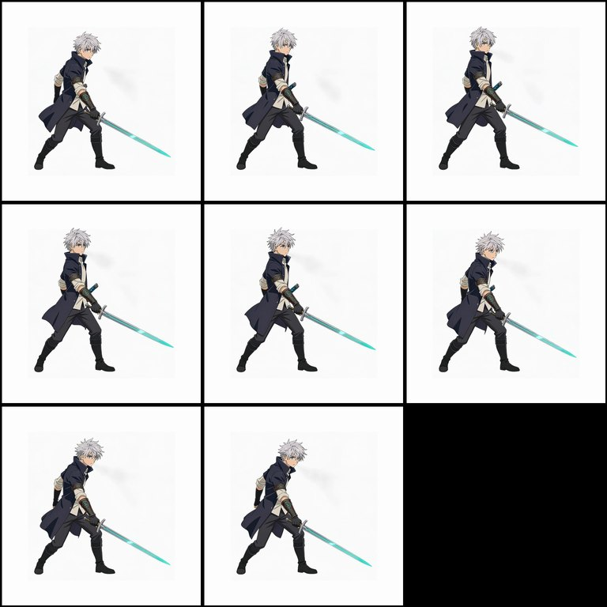
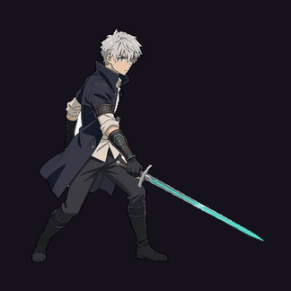

# DreamLayer Tools for Unity (unofficial)

Editor tools that make [DreamLayer](https://dreamlayer.io) images and sprite sheets **game-ready the moment they land
in a Unity project**: sliced sprites, animation clips timed by each frame's own duration, feet pivots, WebGL-friendly
import settings, a provenance file next to every generated image, and an editor window that generates through the
DreamLayer CLI.

Built for, and used to make, the DreamLayer Game Jam game
[*Only Boss Fights: The Fallen Knight*](../../../README.md): every sprite sheet and every DreamLayer image in that
game went through these tools. Unity 6 · editor-only (never compiled into a player) · MIT.

> A community tool by Shawn Zhang. It is not made or endorsed by DreamLayer.

| What DreamLayer returns (an `idle` preset, 8 frames, background kept) | What Unity plays after the tools |
|---|---|
|  |  |

---

## Contents

- [What it does](#what-it-does)
- [Install](#install)
- [Quick start (free, 5 minutes)](#quick-start-free-5-minutes)
- [Sprite-sheet ZIPs](#sprite-sheet-zips)
- [Import rules for single images](#import-rules-for-single-images)
- [The Generate window](#the-generate-window)
- [Cleanup tools (`Tools~`)](#cleanup-tools-tools)
- [How it was validated](#how-it-was-validated)
- [Known limitations](#known-limitations)
- [Troubleshooting](#troubleshooting)
- [License](#license)

## What it does

1. **Sprite-sheet ZIP → sliced sprites + a timed AnimationClip.** Drop a DreamLayer sprite ZIP into the import folder
   and you get the sheet sliced from `atlas.json`'s own rects, one shared pivot at the feet, a clip keyed on each
   frame's `frame_durations_ms` (held poses stay held), a controller, and a report in milliseconds *and* 60 fps
   frames.
2. **Import rules for single images.** Every image under the import folder gets sprite settings on its first import:
   pixels per unit, pivot (feet for characters, center for backgrounds), max size and compression per subfolder.
   A warning catches sizes that silently disable WebGL texture compression.
3. **Tools → DreamLayer → Generate Window.** Generate, edit or cut out an image without leaving Unity: it confirms
   every paid request, gives it an idempotency key, writes a provenance file *before* submitting, and can recover a
   finished result for free.
4. **`Tools~/`**, the Python scripts that ran next to it in a real project: free local background removal for
   `background: keep` sheets (about half the credits), drift and size-drift fixes, foot-locked walk timing.

## Install

**Requirements:** Unity 6 (tested on 6000.6.4f1, URP 2D, WebGL target) and the 2D Sprite package
(`com.unity.2d.sprite`).

**A. Copy the folder.** Copy this folder (`DreamLayer/`) anywhere under your project's `Assets/`. If the 2D Sprite
package isn't installed, add it in Window → Package Manager.

**B. Add it as a package.** Put this folder anywhere on disk, then in Window → Package Manager → **+** → **Add package
from disk…** pick its `package.json`. The 2D Sprite dependency installs automatically, and both samples show up under
the package's **Samples** tab. Unity's "add from git URL" also works with
`?path=/Assets/Editor/DreamLayer`, but it downloads this whole repository (about 0.5 GB of game art), so prefer A or B.

**For the Generate window only:** Node.js 22.12+ on your PATH, the DreamLayer CLI (the window's **Install CLI** button
puts it in `Library/`), and your API key in the `DREAMLAYER_API_KEY` environment variable. Importing never needs any
of these.

## Quick start (free, 5 minutes)

1. **Tools → DreamLayer → Import Sprite Sheet ZIP…** and pick `Samples~/HeroIdle/hero_idle.zip` from this folder
   (Unity hides `~` folders, so browse to it in the file dialog). It is copied to `Assets/Art/DreamLayer/Characters/`
   and imported.
2. You get `Assets/Art/DreamLayer/Characters/hero_idle/`:
   - `hero_idle_sheet.png`: 8 sprites, pivot at the feet;
   - `hero_idle.anim` and `hero_idle.controller`: a looping 2.25 s clip;
   - `hero_idle.import.json`: the report below.
3. Drag `hero_idle.controller` onto a GameObject with a SpriteRenderer and an Animator, then press Play.

From then on, any DreamLayer ZIP you drop under `Assets/Art/DreamLayer/` imports itself.

## Sprite-sheet ZIPs

Three ways in: drop the ZIP under the import folder (it imports automatically), **Tools → DreamLayer → Import Sprite
Sheet ZIP…**, or right-click a ZIP → **DreamLayer → Import Sprite Sheet ZIP**. Re-importing updates the sheet and clip
in place and keeps sprite IDs stable, so every reference keeps working.

| Output | Details |
|---|---|
| `<name>/<name>_sheet.png` | The bundle's `sheet.png`, sliced from `atlas.json`'s rects (TexturePacker-style hash or array, or a plain grid as a fallback), top-left origin flipped for Unity |
| One shared pivot | **Vertically at the feet:** the median of each frame's lowest opaque row. **Horizontally on frame 1's hip** (the centroid of the 50–65% height band), because custom-prompt sheets come back `source_canvas`, framed like the reference, with the body off-center. A sheet that starts in a pose's stance then starts exactly where that pose stands. An atlas `pivot_x` (0–1 across the cell) overrides it |
| `<name>/<name>.anim` | Keyed on each frame's `frame_durations_ms`, never one fixed fps. Loops per `animation_mode`, else `sampling: "cycle"`, else the walk / run / idle presets |
| `<name>/<name>.controller` | Created once, never overwritten |
| `<name>/<name>.import.json` | The report (below) |

**The report** is the frame data a designer needs, plus how steady the sheet is:

```json
{
  "action": "idle",
  "frames": 8,
  "loop": true,
  "total_seconds": 2.25,
  "durations_ms": [280, 280, 280, 280, 290, 280, 280, 280],
  "durations_60fps_frames": [17, 17, 17, 17, 17, 17, 17, 17],
  "pivot": [0.354, 0.16],
  "pixels_per_unit": 256,
  "feet_baseline_spread_px": 0,
  "horizontal_center_spread_px": 3,
  "warnings": []
}
```

**Warnings** cover `kept_background_frames` (frames where DreamLayer's cutout failed), `enlarged` frames, atlas
inconsistencies (for example `duration_ms` not matching the sum of the frame durations), a `source_canvas` sheet in a
feet-pivot folder, a `pivot_x` override, and sheets larger than 2048 px.

## Import rules for single images

Images under the import folder get these settings on their **first** import, so later Inspector changes stick:
Sprite type, alpha is transparency, no mipmaps, compressed, Bilinear filtering, Clamp wrap, plus per subfolder:

| Subfolder of `Assets/Art/DreamLayer/` | Max size | Pixels per unit | Pivot |
|---|---|---|---|
| `Characters/`, `Props/` | 1024 | 256 | feet (bottom-center) |
| `Backgrounds/` | 2048 | 128 | center |
| `UI/` | 1024 | 100 | center |
| anything else | 1024 | 256 | center |

Every import also warns when a width or height **isn't a multiple of 4**: WebGL's DXT/BC compression then silently
ships the texture uncompressed, a common trap with AI images trimmed to their alpha bounds.

**Your own folders and numbers:** **Tools → DreamLayer → Create Import Rules File** writes the defaults to
`ProjectSettings/DreamLayerImportRules.json`. Edit it (keys you leave out keep their defaults); it applies to the next
import, no recompile:

```json
{
  "root": "Assets/Sprites/AI",
  "rules": [
    { "folder": "Heroes", "maxSize": 512, "pixelsPerUnit": 64, "pivot": { "x": 0.5, "y": 0.0 }, "note": "feet" }
  ]
}
```

## The Generate window

**Tools → DreamLayer → Generate Window**:

- **Generate / Edit / Cutout** through the official CLI, imported straight into the chosen folder with its rules. The
  folder list comes from the import rules.
- **Asks before every paid request**, gives it a unique idempotency key, and writes the provenance file *before*
  submitting, so an interrupted run can still be recovered.
- **Recover (free):** paste an execution id to download a finished result instead of paying again.
- Shows the credit balance, and the provenance of whichever DreamLayer image is selected.

The provenance file sits next to the image as `<name>.dreamlayer.json`:

```json
{
  "status": "completed",
  "operation": "image_to_image",
  "prompt": "Keep this exact character. Mid-jump, side view, plain flat background.",
  "reference_image": "Assets/Art/DreamLayer/Characters/hero_idle.png",
  "idempotency_key": "dl-edit-hero_jump-20261011143000",
  "execution_id": "…",
  "submitted_utc": "2026-10-11T14:30:00Z",
  "credits": 1,
  "seconds_to_result": 48.2,
  "output_size": [2048, 2048]
}
```

**Safety:** the API key is read from the environment (on Windows also the user-level variable, so Unity doesn't need
a restart), passed only to the CLI process, and never logged, shown or stored. The CLI runs as `node cli.js …`
without a shell, so a prompt can contain any characters.

## Cleanup tools (`Tools~`)

Python 3.10+ with Pillow and NumPy (`pip install pillow numpy`). Unity ignores `~` folders, so these never touch your
build.

| Script | What it fixes |
|---|---|
| `clean_sprite_zip.py` | Removes the background of a `background: keep` sheet locally (about half the credits of `remove`) and writes the ZIP back with the same atlas. `--snap-feet` puts every frame on one floor row; `--remove-drift` takes out forward travel baked into a cycle ("walking on the spot" is often ignored) |
| `clean_cutout.py`, `defringe.py` | The cutout itself: flood-fill keying from the border, enclosed gaps (`--gap-core`), drawn floor shadows, light fringes |
| `normalize_sheet_scale.py` | Size drift inside a sheet: rescales every frame to frame 1's height, anchored on the feet. `--match-idle IDLE.png` also prints the Flipbook scale against your idle sprite and writes the `pivot_x` that makes the walk start where the idle stands |
| `foot_travel.py` | Foot-locked timing for walks: frame times follow how far the planted foot slides, so the feet don't skate at any walk speed |
| `normalize_pose.py` | Single poses to one scale and anchor |
| `make_walk_ref.py` | A walk reference: the character on a wide canvas with room in front, so drift never pushes a weapon out of its cell |

A typical walk, start to finish:

```bash
dreamlayer sprite walk_ref.png --animation-prompt "<walk, on the spot>" --frames 8 --frame-size 512 \
  --background keep --max-credits 3.5 --idempotency-key <key> --out walk_raw.zip
python Tools~/clean_sprite_zip.py walk_raw.zip --out walk_clean.zip --snap-feet --remove-drift
python Tools~/normalize_sheet_scale.py walk_clean.zip --out walk.zip --match-idle idle.png
python Tools~/foot_travel.py walk.zip
# then drop walk.zip into Assets/Art/DreamLayer/Characters/
```

## How it was validated

- **DreamLayer's own `unity-sprite-import` skill**, whose test plan said it had never been run in Unity, was run in
  Unity 6000.6.4f1. It passes its plan, but for game use it put the pivot at the center (feet 0.5 units below the
  object), hard-coded 128 pixels per unit, left WebGL textures uncompressed, put everything in `Resources/`, ignored
  `sampling` and `kept_background_frames`, and needed a Python + copy step. These tools fix all of those.
- **On DreamLayer's sample** (`Samples~/WalkSample`): 7 sprites, feet at y = −0.004 (was −0.5), Animator playback
  measured at 399–411 ms per frame against 400/410 in the atlas, feet jitter 0 px.
- **In a fresh, empty Unity 6 project** (added from disk, with nothing but the 2D Sprite package it pulls in), a
  batch-mode test passes 15 of 15 checks: both samples (frame count, clip length, loop, feet pivot, report), the
  default rules, and a rules-file override that applies and then reverts.
- **In production:** the jam game imported 9 sprite sheets and 54 single images through it, from a
  [DreamLayer pipeline driven by an AI coding agent](../../../README.md#how-the-pipeline-ran).

## Known limitations

- Single images get their rules on the **first** import only, on purpose. Re-apply by deleting the image's `.meta`.
- One pivot per sheet. A sheet whose frames move the body around the cell (a lunge baked into an attack) needs
  per-frame offsets this importer doesn't write.
- The horizontal hip pivot assumes a roughly upright character in frame 1. A big limb at hip height pulls it
  sideways; set `pivot_x` in the atlas (`normalize_sheet_scale.py --match-idle` computes it).
- The Generate window covers generate, edit and cutout. Sprite sheets and upscales are run from the CLI.

## Troubleshooting

| Symptom | Cause and fix |
|---|---|
| Dropping a ZIP does nothing | It must be under the import folder (`Assets/Art/DreamLayer/` or your rules file's `root`). Or use **Import Sprite Sheet ZIP…** on it |
| The character floats or sinks | The sheet's lowest opaque rows differ per frame: run `clean_sprite_zip.py --snap-feet`, then re-import |
| The walk slides back to its start every loop | Forward drift baked into the cycle: `clean_sprite_zip.py --remove-drift` |
| The character swells and shrinks while walking | Size drift across frames: `normalize_sheet_scale.py` |
| A warning about multiples of 4 | Pad the image (the cleanup tools do) or pack it into a Sprite Atlas |
| The window says the CLI or key is missing | Install Node.js 22.12+ and press **Install CLI**; set `DREAMLAYER_API_KEY` |
| The window shows an uncertain result | Nothing is lost: use **Recover** with the execution id in the status message (free) |

## License

MIT, see [LICENSE.md](LICENSE.md). `Samples~/WalkSample/walk_sample.zip` is DreamLayer's sample from
[TheDesignFounder/dreamlayer-agent-plugin](https://github.com/TheDesignFounder/dreamlayer-agent-plugin) (MIT,
DreamLayer AI). `Samples~/HeroIdle` was generated with DreamLayer for this README and ships under this folder's MIT
license.
