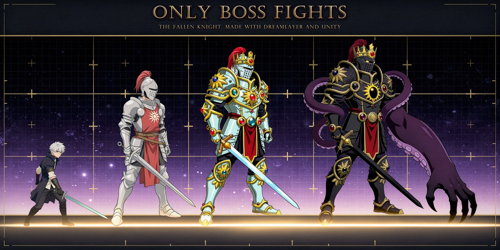

# Only Boss Fights: The Fallen Knight

A short 2D boss rush made in five days for the [DreamLayer Game Jam #1](https://itch.io/jam/dreamlayer-jam-1):
three fights against one villain in three forms, every character and arena made with
[DreamLayer](https://dreamlayer.io), built in Unity 6 for the browser.

**[Play it in the browser on itch.io](https://shawn-zhang1.itch.io/only-boss-fights-the-fallen-knight)** ·
Unity 6000.6.4f1 · WebGL

This repository is the whole project: the game, the raw DreamLayer outputs next to what they became, the tools I
built to make them game-ready, and the notes I kept on every request. It is written for two readers: someone who wants
to see how the game was made, and anyone weighing DreamLayer for a game pipeline.

## Contents

1. [The game](#the-game)
2. [How I used DreamLayer](#how-i-used-dreamlayer)
3. [What worked and what didn't](#what-worked-and-what-didnt)
4. [What I'd ask DreamLayer to build](#what-id-ask-dreamlayer-to-build)
5. [How the pipeline ran](#how-the-pipeline-ran)
6. [The DreamLayer → Unity importer](#the-dreamlayer--unity-importer)
7. [Dev notes: five days](#dev-notes-five-days)
8. [What's in this repository](#whats-in-this-repository)
9. [Run it yourself](#run-it-yourself)
10. [Credits and licenses](#credits-and-licenses)

---

## The game

The realm's finest knight had never lost a duel. Then he lost to you. Power made him a king; the crown wasn't enough;
beneath the throne, something answered. **Only Boss Fights** has no levels and no filler: a lobby with one relic per
fight, and three fights against the same villain, each form teaching something the next one tests.

- **The Fallen Knight** teaches you to **parry**: every strike he means comes with a white glint, 0.3 s before it lands.
- **The Frozen King** teaches you to **move**: ice erupts from the floor and lances fly across his throne room.
- **The Unknown One**, the god wearing his body, asks for both and remixes everything that came before.

The hero can **parry** (a clean parry opens a riposte; parry a whole combo and the boss staggers), **dash** through
red attacks, **flash counter** (dash right after a clash to strike from behind), and **harvest** a boss's fire, ice or
wood spell by parrying it, then send it back with a charged heavy. New players are taught in the fight itself: the
first time each mechanic matters, time stops just before the hit and shows the key.

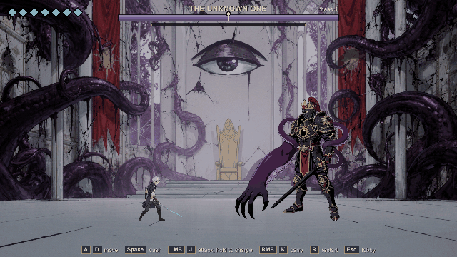

| | |
|---|---|
| 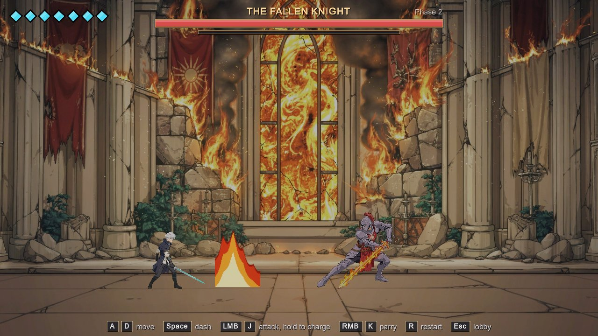 | 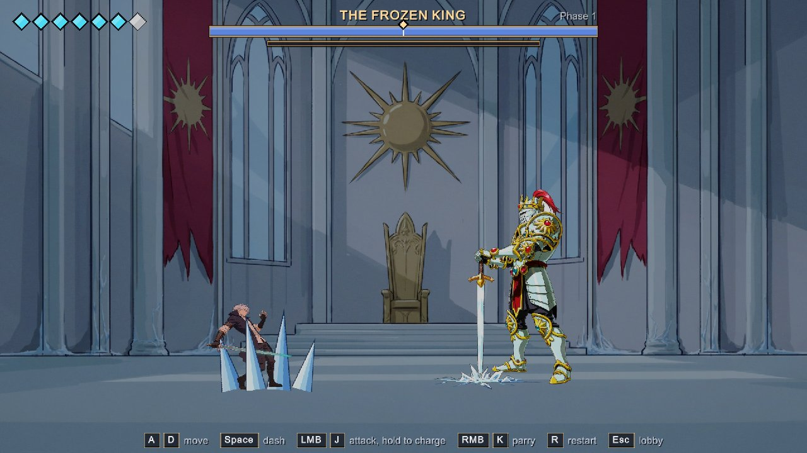 |
| 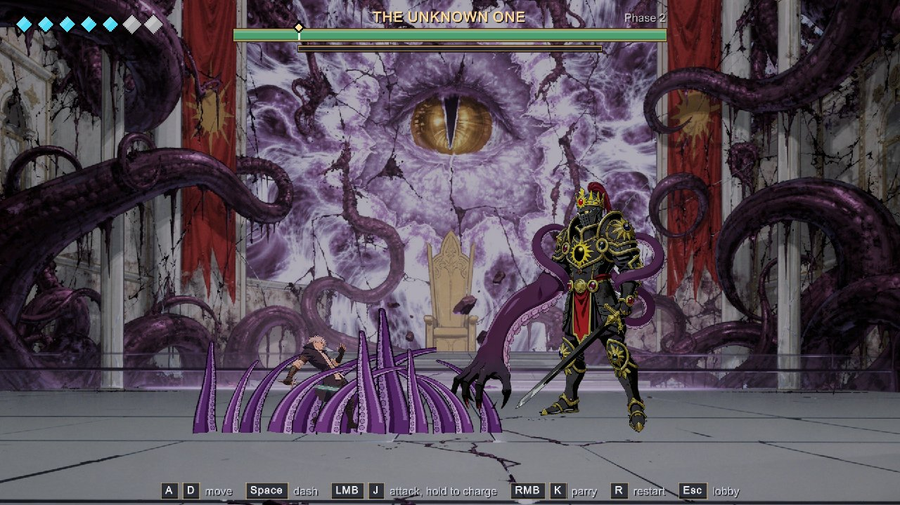 | 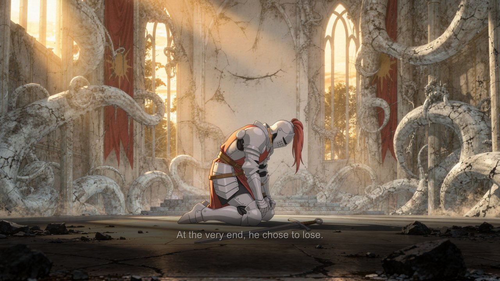 |

---

## How I used DreamLayer

**Every character, every arena, the relics and the ending illustration were made with DreamLayer.** That's 60 assets
in the game, plus the itch.io cover and this README's header:

| In the game | Count | Notes |
|---|---|---|
| Character poses | 43 | the hero (11), the Knight (14), the King (8), the Unknown One (10) |
| Animations (sprite sheets) | 6 | the hero's slash, combat step and lobby walk; a walk for each form of the villain |
| Painted backgrounds | 8 | three arenas and an edit of each for its phase 2, the lobby, the ending |
| Relics | 3 | the sword, the crown and the eye, from one sheet |

**Spent:** 99 of the jam's 100 credits on 74 requests (57 edits, 11 sprite sheets, 6 generations). Every request is
in [docs/credits-log.md](docs/credits-log.md) with its execution id, idempotency key, cost and verdict, and the raw
output and its prompt are in [`ArtRaw/`](ArtRaw) next to what it became. Everything that isn't DreamLayer art is code: the
effects (fire, ice spikes, tentacles, slash trails, dust) and the UI are drawn at runtime. The music and sound are CC0.

### One villain, three forms, one image edited step by step

The game's hook is DreamLayer's core strength: keeping one character consistent through edits. I made the Fallen
Knight first and approved him as the master reference. He was edited into the Frozen King, and the King into the
Unknown One. Every pose of each form is an edit of that form's reference, so the helm, the plume, the crown and the
sword carry through all three fights, and the sun on his chest becomes the god's eye.

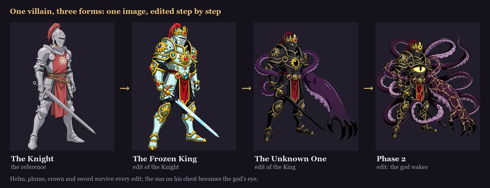

### One room, many edits

The Knight's hall was edited into a burning hall for his phase 2. The King's throne room was generated once, then
edited three times: frozen over for his phase 2, taken by the god for the final fight, and torn open for its phase 2.
The floor line held through every edit, so each phase change crossfades in place.

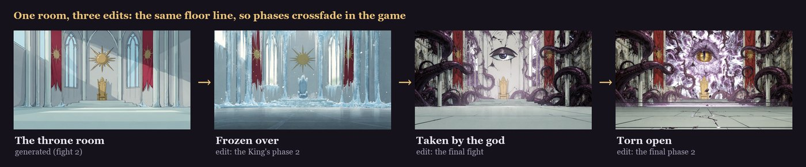

### Poses that are gameplay

Every fight was playable and tuned with plain boxes before any art existed. The DreamLayer poses went onto the same
frame data, and each move has its own silhouette: the windup tells you *what* is coming before the glint tells you
*when*. A raised sword means parry, a cast means a spell, a sword planted in the floor means move.

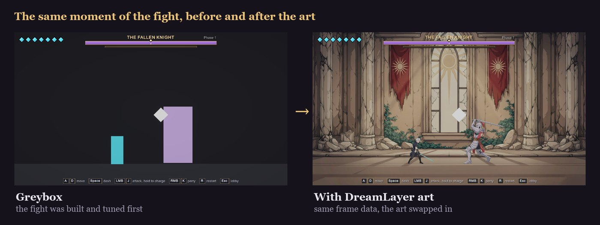

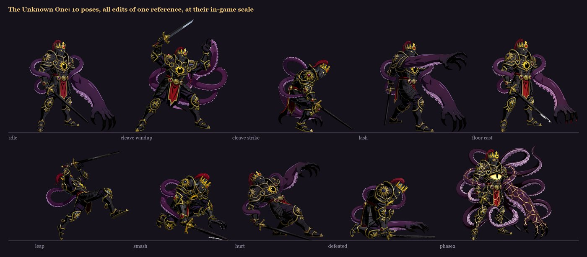

### Two references in one

A request takes one reference image, so the ending illustration, the cover and this README's header are edits of
composites. For the ending, the Knight's defeated pose from the first fight was pasted into the final arena and came
back as one scene at dawn.

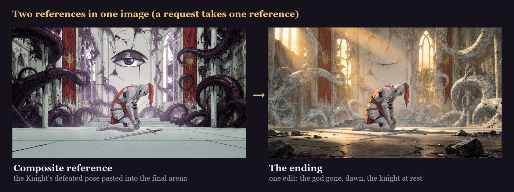

---

## What worked and what didn't

I logged every request as I went: the reference, the exact prompt, what held, what drifted, what I rejected, and
what it cost ([docs/dreamlayer-notes.md](docs/dreamlayer-notes.md), 24 entries;
[docs/metrics.md](docs/metrics.md)).

### What worked

- **Identity.** The villain stayed recognizable through three forms and more than 40 poses; the King's 8 poses and
  the Unknown One's 10 never lost the helm, plume, crown or sword. The hero held across 11 poses and 3 animations.
- **Walk cycles: 6 of 6 usable on the first try** (the hero's combat step twice, the lobby walk, and all three forms
  of the villain). A walk is slow enough that every frame is a clean key pose with a planted foot.
- **Small edits keep the composition to the pixel.** The Knight's flaming swing has the same bounding box as his plain
  strike, so it reused the same scale ruler.
- **Arena edits keep the floor line.** Four arena edits, each one a drop-in phase change.
- **Object counts in the prompt** ("exactly one sword", "exactly one clawed tentacle arm") fixed the duplicated props
  of earlier requests.
- **Composite references** worked every time: the ending, the cover and the header each came back on the first try.
- **`background: keep` plus a local cutout** halved the price of every sprite sheet with no loss for game use.

### What didn't

**The lobby run.** The hero walks between relics in the lobby, and crossing the hall took nine seconds, so I tried
running. Three run sheets (10 credits), none shipped:

- The **run preset** in the fight re-posed the sword every frame, three of its frames were leaps, and played backwards
  (the hero always faces the boss) it moonwalked. It became a custom "combat step" prompt instead, which worked.
- **Lobby run v1** had a real stride, but the front arm stayed raised in every frame. No retiming can fix a pose that's
  in every frame.
- **Lobby run v2** spelled out the arm swing. The arms swung, but the legs turned into an upright high-knee jog on the
  spot.

My call after watching both in the game: *"just use walk ... it looks the most natural. those all look off the
running, I think is the problem of gen ai sprite."* A run is mostly in-between motion (flight, arm swing, lean), and
that's where the generated cycles fell apart. The lobby walk shipped.

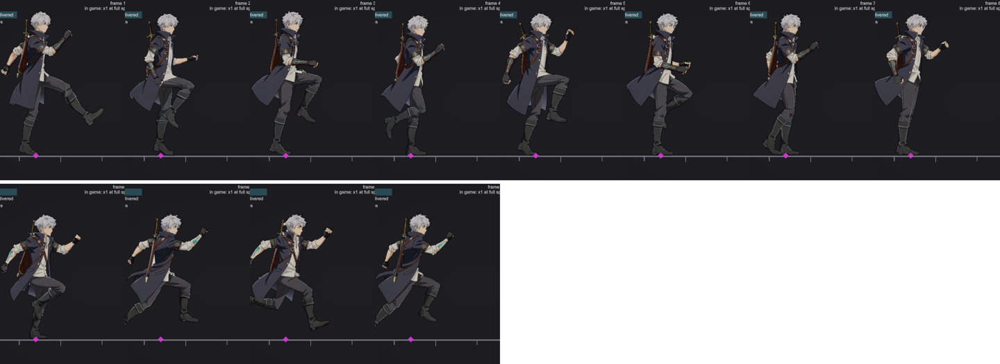

**Size drift.** Edits on the same canvas came back at different scales: the King's poses ranged from +0% to +22%
against his idle (median +10%), and a playtest caught him growing and shrinking between moves. Every pose is now
measured against a body ruler and normalized before import ([`Tools/import_poses.py`](Tools/import_poses.py)). The
same thing happens *inside* sprite sheets: the King's walk grew 22% from its first frame to its last, the Unknown
One's 17%. [`normalize_sheet_scale.py`](Assets/Editor/DreamLayer/Tools~/normalize_sheet_scale.py) scales every frame
back.

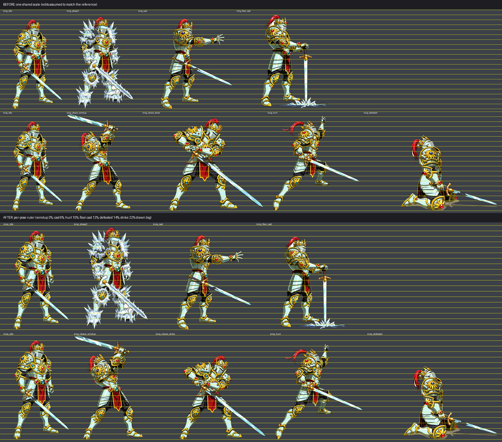

**Cycles that travel.** Custom cycles walked forward in their cells even when the prompt said "on the spot": 113 px
of a 512 px cell on the hero's combat step (22%), 97 px on the Knight's walk. Played as a loop, the character slides
and snaps back. `--remove-drift` takes it out. Later prompts were honored more often (the lobby walk drifted
0.4 px a frame).

**Props and pieces that multiply or move.** A second sword on the Knight's slam, a doubled tentacle arm on the Unknown
One's lash, and, on the idle sheet made for this README, a second sword hilt on the hero's back that wasn't in the
reference. 4 of 11 poses in one batch came back facing left. One reference option reframed itself into a close-up.

**Cleanup is part of the job.** Drawn floor shadows and effect bursts survive background removal; enclosed gaps (between
legs, inside tentacle loops) keep the background; a strict key eats pale highlights like the King's ice blade. Each
needed its own local fix in [`Tools/`](Tools).

**One reference per request.** Composites are the workaround, and they only work when the pieces can be laid out by
hand in the final composition.

---

## What I'd ask DreamLayer to build

- **A scale lock** for edits and sprite sheets, or a `scale_spread` field in the sheet's `atlas.json`, so size drift is
  reported instead of discovered in a playtest.
- **A ground point per frame** in `atlas.json`. `source_canvas` sheets leave every engine to guess the pivot, and a big
  limb (the Unknown One's claw arm) breaks the guess.
- **Cycles that really stay in place**, or an `in_place: true` option. Every game engine moves the character itself.
- **Several references per request, each with a role** ("this character", "this place", "this style").
- **Prop consistency:** a "use only what's in this image" mode, so a preset doesn't pull in an item from another asset
  of the same character.
- **Validated engine imports.** DreamLayer's own Unity import skill had never been run in Unity; the importer in this
  repository is a tested version of it.

---

## How the pipeline ran

The project ran agent-first. I designed, directed, playtested and approved every credit; **Claude Code** (an AI coding
agent) wrote most of the implementation and drove both tools from the command line: the Unity editor through Unity's
CLI (scenes built by script, play-mode bots, captures, WebGL builds) and DreamLayer through its CLI. The agent worked
from a written project brief (`CLAUDE.md`, kept private; some docs refer to its sections).

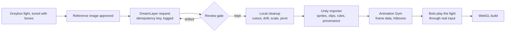

- **Before a credit:** the docs, DreamLayer's own Unity import validated for free on their sample, and a written
  pipeline ([docs/image-api-best-practices.md](docs/image-api-best-practices.md)).
- **Every request:** an explicit operation, an idempotency key, the prompt saved next to the output, and a line in
  [docs/credits-log.md](docs/credits-log.md). On a dropped connection, recover by execution id; never resubmit.
- **Review gates:** identity, scale, anchor and cutout, scored with
  [docs/game-readiness-rubric.md](docs/game-readiness-rubric.md).
- **The Animation Gym** (`Assets/Scenes/AnimGym.unity`) plays every pose and sheet on its real frame data, with
  hitboxes and onion skin, so generated animation is judged as gameplay, not as a GIF.
- **Bots** play each fight through a virtual keyboard (the same input path as a player) to check parry, riposte,
  dash, stagger, phase 2 and the lobby flow.

---

## The DreamLayer → Unity importer

[`Assets/Editor/DreamLayer/`](Assets/Editor/DreamLayer) is a drop-in, editor-only tool, tested on its own in a fresh
Unity 6 project:

- **Sprite-sheet ZIPs** become sliced sprites and an AnimationClip timed by each frame's own `frame_durations_ms`,
  with a feet pivot and a report in 60 fps frames.
- **Import rules** give every DreamLayer image the right pixels per unit, pivot, max size and WebGL compression.
- **A Generate window** generates, edits and cuts out through the CLI, with a credit confirmation, an idempotency key
  and a provenance file per image.
- **`Tools~/`** holds the cleanup scripts: local background removal, drift, size drift, foot-locked timing.

Full documentation, install steps and samples: [Assets/Editor/DreamLayer/README.md](Assets/Editor/DreamLayer/README.md).

---

## Dev notes: five days

The full devlog, with every decision, playtest, number and lesson, is [docs/devlog.md](docs/devlog.md). The short
version:

- **Day 1: a playable greybox.** Project, agent pipeline and WebGL deploy on day one. The boss rush concept (one villain,
  many forms), a greybox Knight fight built and verified by the agent, and a first playtest: *"parry is hard to use"*.
  The fix became the game's language: the pose says *what*, a glint 0.3 s before the hit says *when*, plus a clash
  for players who attack into the hit.
- **Day 2: references and tooling.** I researched before spending: a style test, an anime style board, then the hero
  and the Knight locked together on one cast sheet. The importer was built and validated. Harvest (parry a spell to
  keep it) went into the greybox. The first art pilot, and the first failed run sheet.
- **Day 3: poses.** The smoothness batch (11 poses and a slash sheet whose impact frames land on the attack's active
  frames), and walks that line up with the poses they start from.
- **Day 4: the world.** Arenas and their phase-2 edits, the lobby and relics, Boss 1 finished, the flash counter, sound
  and music, the King and the Unknown One designed and playable in greybox, the story, solid bodies, the name.
- **Day 5: the King, the god, and shipping.** The King's art and his size problem, the Unknown One's art and his
  tentacles, the lobby run that didn't make it, the ending illustration, the WebGL build and itch.io page, a
  first-time experience that teaches in the fight, and walks for the last two forms.

---

## What's in this repository

| Path | What |
|---|---|
| `Assets/Scripts/` | The game: hero and boss state machines, combat, feel (hit-stop, shake, effects), the lobby, the HUD and the first-time coach |
| `Assets/Art/DreamLayer/` | The DreamLayer art in the game, each image with a `.dreamlayer.json` provenance file |
| `Assets/Editor/DreamLayer/` | The DreamLayer → Unity importer and its cleanup tools |
| `Assets/Data/` | Every boss move, attack and pose set as data (ScriptableObjects) |
| `Assets/Scenes/` | The lobby, the three fights, and the Animation Gym |
| `ArtRaw/` | The raw DreamLayer outputs, references, prompts and execution records, next to the cleaned versions |
| `AgentScripts/` | Editor scripts the agent ran: scene builders, art wiring, bots |
| `Tools/` | Python: cutout, pose normalization, imports, sound synthesis, itch.io and README images |
| `docs/` | The devlog, the DreamLayer dogfooding notes, metrics, the credits log, the design docs |

---

## Run it yourself

1. Install **Unity 6000.6.4f1** (other Unity 6 versions will likely work) and open this folder as a project.
2. Open `Assets/Scenes/Lobby.unity` and press Play. The fights can also be opened directly (`Boss01`, `Boss02`,
   `BossFinal`).
3. Build for the browser with **Tools → Build → WebGL for itch.io** (or `BuildScript.WebGL` in batch mode). The output
   goes to `Builds/WebGL` and `Builds/itch-webgl.zip`.

Controls: A / D move, Space dash, left click or J attack (hold to charge), right click or K parry, R restart, Esc
lobby.

---

## Credits and licenses

**Made by Shawn Zhang** (design, direction, art direction, playtesting), with **Claude Code** writing most of the code
and **DreamLayer** for all the art.

- **Code** (`Assets/Scripts`, `Assets/Editor`, `AgentScripts`, `Tools`): MIT, see [LICENSE.md](LICENSE.md).
- **Art and writing** (`Assets/Art`, `ArtRaw`, `docs`, the story): © 2026 Shawn Zhang, all rights reserved. Made with
  DreamLayer; output rights belong to the creator under DreamLayer's terms.
- **Music and sound:** CC0, by Juhani Junkala, Emma_MA, Fupi, congusbongus and Kenney; the rest synthesized for the
  game. Full list: [docs/credits.md](docs/credits.md).
- `Assets/Editor/DreamLayer/Samples~/WalkSample` is DreamLayer's sample sprite sheet (MIT, DreamLayer AI).
